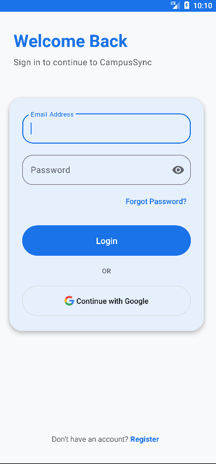
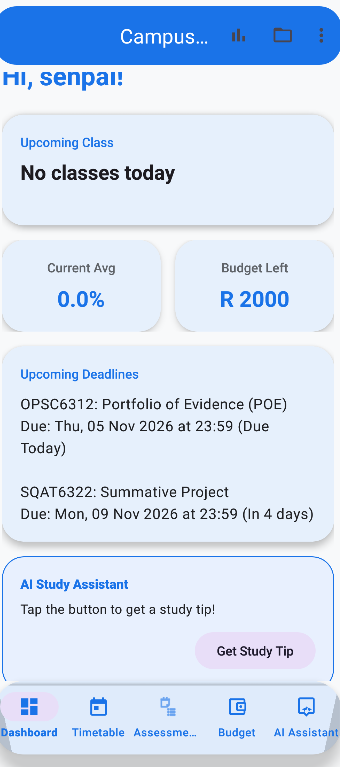
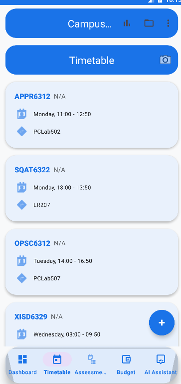
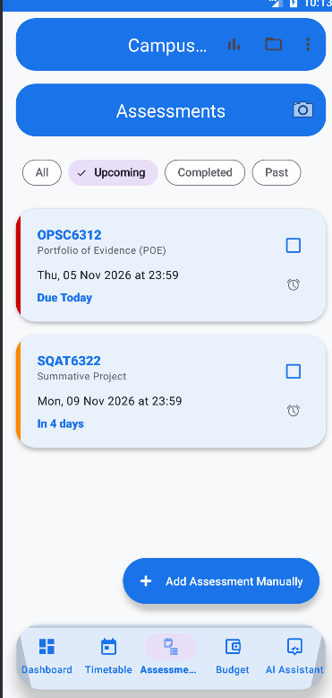
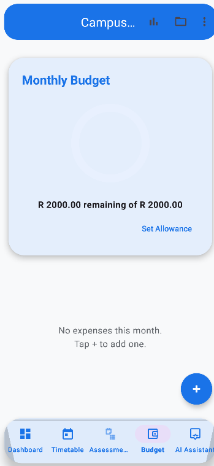
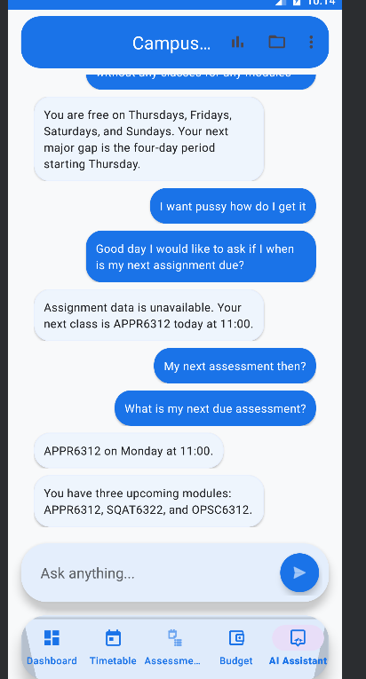
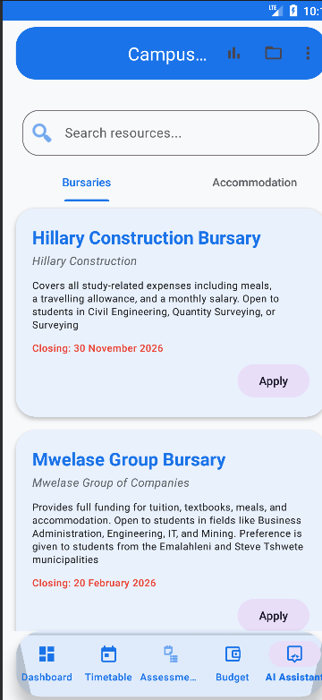
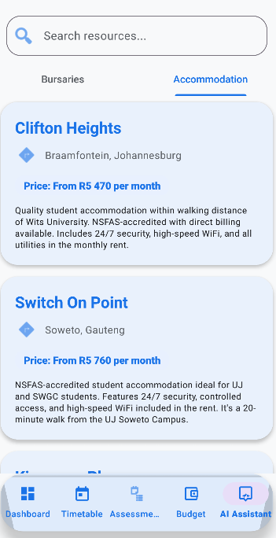
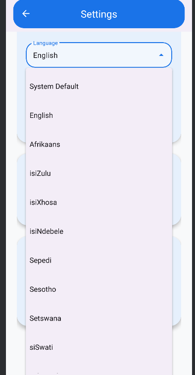

# CampusSync 📱

> **Your Academic & Resource Command Center.**
> Designed for Rosebank International students in South Africa.

[](https://kotlinlang.org/)
[](https://android-arsenal.com/api?level=24)
[](https://m3.material.io)

---

## 📖 Overview

**CampusSync** is a comprehensive tertiary student management platform built for the **Independent Institute of Education (IIE)** module **OPSC6312 (Open Source Coding Intermediate)**.

The app centralizes academic planning, grade tracking, budgeting, and resource discovery into a single, mobile-first experience. We built this specifically for students in the **Diploma in IT in Software Development (DISD)** programme at **Rosebank International**. To make student life easier, the app leverages the Google Gemini API to automate tedious tasks like scanning paper schedules and assessment guides, and uses Firebase for secure, real-time data syncing.

---

## 📸 App Screenshots

| Login & Register | Home Dashboard | Timetable & Marks |
| :---: | :---: | :---: |
|  |  |  |

| Assessments | Budget Tracker | AI Chatbot |
| :---: | :---: | :---: |
|  |  |  |

| Bursaries | Accommodation | Settings & Multi-Language |
| :---: | :---: | :---: |
|  |  |  |

---

## ✨ Features

### 🎓 Academic Management
*   **Smart Timetable**: Full CRUD support for your weekly schedule, with real-time syncing.
*   **Grade Tracker**: Automatically calculates your overall weighted average.
*   **Assessment Hub**: Track deadlines with color-coded urgency and custom filters.

### 🤖 AI Innovation (Powered by Gemini)
*   **AI Student Assistant**: A context-aware chatbot that reads your live Firestore data (grades, budget, timetable) to give personalized advice.
*   **AI Timetable Scanner**: Upload a photo of your schedule; Gemini Vision extracts the text and formats it into your app.
*   **AI Assessment Scanner**: Extract deadlines directly from a Programme Assessment Schedule (PAS) image, filtering automatically by your year of study.

### 🔔 Real-time Notifications & Customisation
*   **Custom Sticky Notifications**: Set custom date/time reminders for specific assignments using WorkManager. Notifications stay on screen until explicitly dismissed.
*   **In-App Preferences**: Users can toggle notifications on/off and choose how many days in advance they want to be reminded.

### 🔐 Authentication & Security
*   **Google SSO**: Seamless single sign-on using the modern Credential Manager API.
*   **Secure Email Login**: Standard email/password login with full input validation.
*   **Firebase Security Rules**: Ensures students can only read and write their own data.

### 🌍 Multi-Language Support
*   **12 SA Languages**: Users can switch between English, Afrikaans, isiZulu, isiXhosa, isiNdebele, Sepedi, Sesotho, Setswana, siSwati, Tshivenda, and Xitsonga using the modern Per-App Language API.

### 💰 Student Life Resources
*   **Budget Tracker**: Manage your monthly allowance with category-based spending and visual progress indicators.
*   **Resource Hub**: A searchable directory populated with real South African bursaries and student accommodation options.

---

## 🛠 Tech Stack

| Component | Technology |
| :--- | :--- |
| **Language** | Kotlin 2.2.10 |
| **UI Framework** | XML Layouts (Material Design 3) |
| **Minimum SDK** | 24 (Android 7.0 Nougat) |
| **Backend** | Firebase (Auth, Firestore) |
| **AI Engine** | Google Gemini API |
| **Background Tasks** | WorkManager |
| **Networking** | OkHttp 4.12.0 |
| **JSON Parsing** | Gson 2.11.0 |
| **Architecture** | Repository Pattern with Coroutines |

---

## 🏗 Architecture

CampusSync follows the **Repository Pattern**, promoting a clean separation of concerns between the UI, domain logic, and data sources.

1.  **UI Layer**: Fragments and Activities utilizing **View Binding**.
2.  **Repository Layer**: Mediator between the UI and data sources.
3.  **Data Layer**: Remote (Firestore), AI (Gemini), and Local Notifications (WorkManager).

---

## 🚀 Getting Started

1.  Clone the repository:
    ```bash
    git clone https://github.com/brandondlmn-alt/CampusSyncs.git